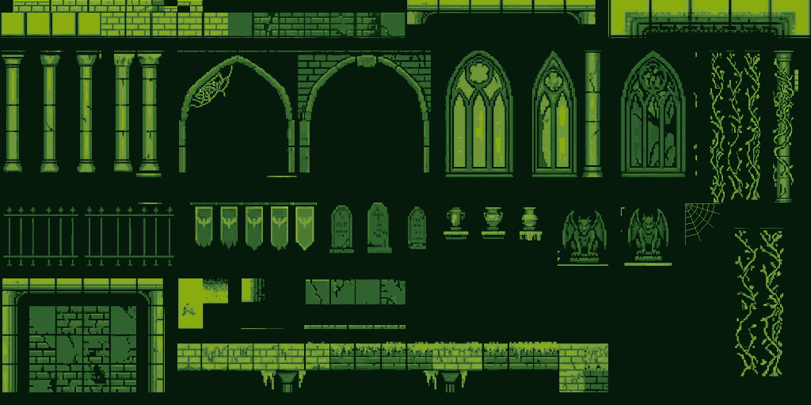
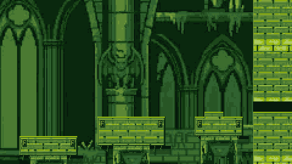
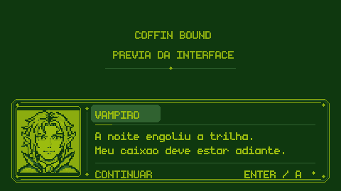
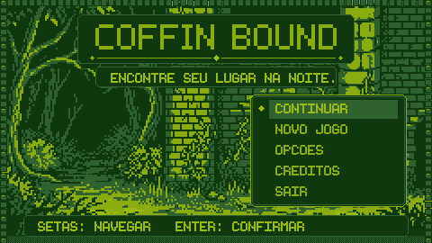
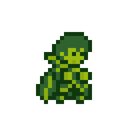
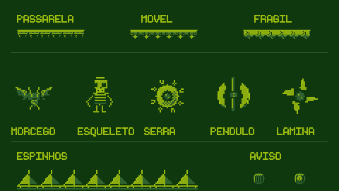

# Coffin Bound



*Version 0.2.4 modular atlas: 16px grid, 16 greens, editable LibreSprite source and native GameMaker tileset. [Editor guide](docs/TILESET_CATEDRAL.md), in Portuguese.*



*Version 0.2.3 scenery adapted from the supplied reference with a 16-green Game Boy style palette. Static art preview; [production and manual checks](docs/CATEDRAL_DETALHADA.md), in Portuguese.*



*Static UI composition for 0.2.1, adapted from Pedro's supplied reference in four Game Boy
colors using LibreSprite. Editable sources: [Dialogue artwork](docs/DIALOGOS.md), in Portuguese.*



*Design preview, not a runner screenshot. Production notes and pending manual checks:
[UI and menu](docs/INTERFACE_MENU.md), in Portuguese.*

[Português](README.md)

A 2D pixel art platformer about a vampire trying to find his coffin. Cross a crypt, avoid light and spikes, climb walls, and turn into a bat to find your way home. Created by **Pedro Tescaro** in **GameMaker**, with movement inspired by Celeste.



*Animation asset preview; this is not a recording of the running game. Gameplay screenshots and build GIFs still need to be captured.*

The project contains one level with three checkpoints, menus, pause, a death screen, credits, options, saved progress and original audio. Movement includes coyote time, jump buffering, variable jump height, wall jumps, dashing and bat transformation. Rendering uses a 480×270 logical resolution, 16×16 tiles and integer scaling.

**Release status:** publication preparation. Static checks and regression coverage are recorded in [Phase deliveries](docs/ENTREGAS.md), in Portuguese. Full playthrough, visuals, audio and runner performance still need approval in the [QA checklist](docs/QA.md). The original artwork's provenance and redistribution license remain undocumented and are excluded from the code's GPL. The owner requested publication of the repository; this does not grant an additional reuse license for those images.



*Static asset preview for 0.2.2, drawn/exported in LibreSprite with four colors. [Files and pending manual checks](docs/PLATAFORMAS_INIMIGOS.md), in Portuguese.*

## Default controls

| Action | Keyboard | Xbox-style controller |
| --- | --- | --- |
| Move / aim abilities | A/D and W/S or arrow keys | Left stick or D-pad |
| Jump; hold for more height | Space | A / bottom face button |
| Dash | C + direction | B / right face button + direction |
| Turn into a bat; automatically return when landing | F | X / left face button |
| Pause / resume | Esc or P | Start |
| Confirm menu / advance dialogue | Enter or Space | A |
| Go back in menus | Esc | B |
| Restart at checkpoint | R or pause menu option | Pause menu option |
| Retry after death | Enter, Space or R | A |
| Fullscreen on Windows | F11 or Options | Options |
| Toggle retro filter | G or Options | Options |
| Debug display | F3 | — |

Human form returns automatically on landing; F starts the transformation and does not manually toggle it in midair.

In **Options → Keys**, the seven player actions can be rebound to letters, numbers, Space or Shift. G/P/R, interface commands and arrow keys are reserved; the arrows remain fixed alternatives. Rebinding currently applies to the keyboard; controller buttons retain the mapping above. In browsers, use the itch.io/browser fullscreen button.

Progress and preferences are stored separately in the GameMaker sandbox as `coffin_bound_save.ini` and `coffin_bound_settings.ini`. **New game** resets progress; **Continue** resumes the saved checkpoint. HTML5 persistence depends on the browser allowing local storage. The in-game interface is currently in Portuguese; this English README does not indicate an English localization of the game.

## Open and run

1. Clone or download the complete repository.
2. Use a GameMaker installation compatible with a project saved in IDE **2026.0.0.16**. Keep a copy before accepting version conversion.
3. Open **`Coffin Bound final.yyp`**. The `.yyz` preserved in history is an original-version backup; the working project is the `.yyp`.
4. If the IDE requests the font, install `fonts/fnt_monogram/monogram.ttf`. Font atlases are included; check IDE warnings when regenerating them.
5. Select **Windows / VM** in Target Manager and press Run. Check fonts, prefabs, masks and display using the [rendering checklist](docs/RENDERIZACAO.md).

The repository does not include GameMaker executables, runtimes or credentials. A configured local installation does not establish that an exported build has passed QA. Windows VM compilation passed with Igor LTS runtime 2026.0.0.23. The HTML5 attempt stopped because the local runtime lacks `html5/scripts.html5.zip`. See [Build results](docs/COMPILACAO.md), in Portuguese.

## Build and distribute

An initial Windows package was generated with Igor `PackageZip`. The user confirmed that
its main menu displays normally; full gameplay QA is still pending. Use
`tools/build.ps1 -Package` and `tools/check_package.py` to generate and inspect the ZIP.
See the [Windows QA report](docs/QA_WINDOWS.md), in Portuguese, for the evidence and limits.

For Windows, select **Windows / VM**, choose **Create Executable**, and generate a ZIP containing the complete runner package. Extract and test that package outside the IDE before uploading it. YYC requires the SDK/Visual Studio supported by your GameMaker version. See the [official Windows build guide](https://gamemaker.io/en/help/articles/windows-compiling-your-app).

HTML5 remains **conditional on a successful build and browser tests**. Select HTML5, test through a server and export a ZIP containing `index.html` at its root, with dependencies and relative paths preserved. Opening the file directly from Explorer is not a publication test. See [GameMaker HTML5 setup](https://gamemaker.io/en/help/articles/setting-up-for-html5) and the [release guide](docs/ITCH_IO.md), including butler commands and capture recommendations.

When distributing a GPL executable, provide the license and corresponding source for that same version, including the files needed to rebuild it. See [License scope](docs/LICENCAS.md). Exclude personal files, tokens and caches from release packages.

## Development checks

Require Python 3 and Node.js; they do not launch GameMaker:

```powershell
python tools/validate_project.py
node --preserve-symlinks-main tools/check_movement.cjs
node --preserve-symlinks-main tools/check_services.cjs
python tools/generate_audio.py --check
```

The validator checks asset registration, references, events, declared PNGs and delimiter balance in first-party GML. Node checks simulate selected logic in a sandbox; they do not compile GML or reproduce runner execution. Audio checks verify deterministic files, not listening quality.

See [tools/arte](tools/arte/README.md) for the LibreSprite export pipeline. The palette and spritesheets are in `assets/palette/` and `assets/spritesheets/`. Audio details and licenses are in [Audio](docs/AUDIO.md).

## Licenses and credits

Copyright © 2026 **Pedro Tescaro**. **First-party code** is licensed under **GPL-3.0-only**; the full text is in [LICENSE](LICENSE). Input and Scribble retain their MIT licenses; fonts, controller data and prefabs have separate terms. The nine original `snd_cb_*` WAVs are CC0-1.0.

The code's GPL **does not license the original artwork**. Sprites, tiles, backgrounds and their derivatives, exports and previews require provenance and redistribution confirmation. See [Licenses](docs/LICENCAS.md) and [Third-party notices](THIRD_PARTY_NOTICES.md).

Documentation: [Changelog](CHANGELOG.md) · [Phase deliveries](docs/ENTREGAS.md) · [Polish](docs/POLIMENTO.md) · [QA](docs/QA.md) · [itch.io and builds](docs/ITCH_IO.md).

Version 0.2.0: strict four-green Game Boy palette, reference-based portrait and three difficulty rooms. Moving/falling/one-way platforms, timed blades, pendulums and contact-damage enemies. Windows compilation passed; full playthrough and balance require manual QA. See docs/TAREFAS_VERDE.md.
