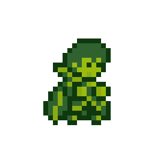
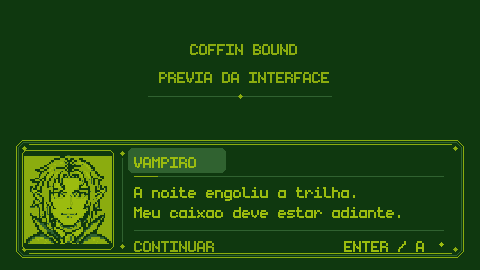
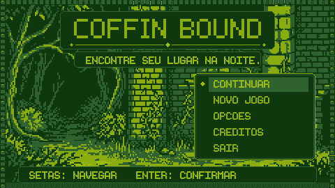
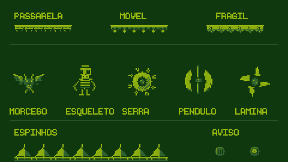

# Coffin Bound

[English](README.en.md)

Um platformer 2D em pixel art sobre um vampiro tentando encontrar seu caixão. Atravesse uma cripta, evite luz e espinhos, escale paredes e transforme-se em morcego para alcançar o caminho de volta. Criado por **Pedro Tescaro** em **GameMaker**, com movimento inspirado em Celeste.



*Prévia dos assets de animação; não é uma captura do jogo em execução. Capturas de gameplay e GIFs do build ainda precisam ser gravados.*



*Composição estática da interface 0.2.1, com moldura e retrato adaptados da referência
fornecida por Pedro, em quatro cores Game Boy. Produção no LibreSprite; veja [Diálogos](docs/DIALOGOS.md).*



*Composição para revisão visual; não é captura do runner. Fontes editáveis e testes em
[Interface e menu](docs/INTERFACE_MENU.md).*

O projeto contém três fases com checkpoints, menu, pausa, tela de morte, créditos, opções, progresso salvo e áudio original. O código de movimento inclui coyote time, buffer de pulo, altura variável, wall jump, dash e transformação em morcego. A apresentação usa resolução lógica de 480×270, tiles de 16×16 e escala inteira.

**Estado da versão:** preparação para publicação. Os testes estáticos e as regressões estão descritos em [Entregas por fase](docs/ENTREGAS.md). A aprovação do percurso completo, do visual, do áudio e da performance no runner está pendente no [checklist de QA](docs/QA.md). A origem/licença das artes originais continua por documentar e não está incluída na GPL do código. A publicação do repositório foi solicitada pelo titular; isso não concede uma licença adicional para reutilizar essas imagens.



*Prévia estática dos sprites 0.2.2, desenhados/exportados no LibreSprite em quatro cores. [Arquivos e testes manuais](docs/PLATAFORMAS_INIMIGOS.md).*

## Controles padrão

| Ação | Teclado | Controle com layout Xbox |
| --- | --- | --- |
| Mover / direcionar habilidades | A/D e W/S ou setas | Analógico esquerdo ou direcional |
| Pular; segurar para maior altura | Espaço | A / botão inferior |
| Dash | C + direção | B / botão direito + direção |
| Transformar em morcego; retorno automático ao pousar | F | X / botão esquerdo |
| Pausar / continuar | Esc ou P | Start |
| Confirmar menu / avançar diálogo | Enter ou Espaço | A |
| Voltar no menu | Esc | B |
| Reiniciar no checkpoint | R ou opção da pausa | Opção da pausa |
| Tentar novamente após morrer | Enter, Espaço ou R | A |
| Tela cheia no Windows | F11 ou Opções | Opções |
| Alternar filtro retro | G ou Opções | Opções |
| Mostrar diagnóstico | F3 | — |

O retorno à forma humana ocorre automaticamente ao pousar; F inicia a transformação, sem alternância manual no ar.

Em **Opções → Teclas**, as sete ações do personagem podem ser remapeadas para letras, números, Espaço ou Shift. G/P/R, comandos da interface e setas são reservados; as setas continuam como alternativa fixa. O remapeamento atual é de teclado; os botões do controle mantêm o mapeamento acima. No navegador, use o botão de tela cheia do itch.io/navegador.

O progresso e as preferências usam arquivos separados no sandbox do GameMaker: `coffin_bound_save.ini` e `coffin_bound_settings.ini`. **Novo jogo** reinicia o progresso; **Continuar** retoma o checkpoint salvo. No HTML5, a persistência depende do armazenamento permitido pelo navegador.

## Abrir e executar

1. Clone ou baixe este repositório completo.
2. Use uma instalação do GameMaker compatível com o projeto, salvo na IDE **2026.0.0.16**. Mantenha uma cópia antes de permitir conversão de versão.
3. Abra **`Coffin Bound final.yyp`**. O `.yyz` preservado no histórico é um arquivo de backup da versão original; o projeto de trabalho é o `.yyp`.
4. Se a IDE pedir a fonte, instale `fonts/fnt_monogram/monogram.ttf`. Os atlas das fontes já estão incluídos; confira avisos da IDE ao regenerá-los.
5. Selecione **Windows / VM** no Target Manager e execute pelo botão Run. Confira fonte, prefabs, máscaras e resolução seguindo [Renderização](docs/RENDERIZACAO.md).

O projeto não inclui executáveis do GameMaker, runtimes ou credenciais. A configuração de uma instalação local não comprova que o build exportado passou pelo QA. A compilação Windows VM via Igor LTS 2026.0.0.23 passou. A tentativa HTML5 parou por falta do módulo `html5/scripts.html5.zip` no runtime local. Detalhes e reprodução em [Compilação](docs/COMPILACAO.md).

## Compilar e distribuir

Para Windows, selecione **Windows / VM**, use **Create Executable** e gere um ZIP com todos os arquivos do runner. Extraia e teste esse pacote fora da IDE antes de enviá-lo. YYC exige o SDK/Visual Studio suportado pela sua versão do GameMaker. Veja as [instruções oficiais de Windows](https://gamemaker.io/en/help/articles/windows-compiling-your-app).

Também é possível gerar o ZIP por Igor com `tools/build.ps1 -Package` e conferir seus arquivos
com `tools/check_package.py`. A fase 6 gerou um pacote local e recebeu confirmação do usuário
de que o menu inicial aparece normalmente. Veja [QA Windows](docs/QA_WINDOWS.md) para os
comandos e testes ainda necessários; o build ainda não é uma release de jogabilidade aprovada.

HTML5 é um alvo **condicionado a compilação e teste**. Selecione HTML5, teste por servidor e exporte um ZIP com `index.html` na raiz, mantendo as dependências e os caminhos relativos. Não use abrir o arquivo diretamente pelo Explorer como teste de publicação. Confira [configuração HTML5 do GameMaker](https://gamemaker.io/en/help/articles/setting-up-for-html5) e o [guia de publicação](docs/ITCH_IO.md), com comandos butler e orientações de capturas.

Ao distribuir um executável GPL, acompanhe a licença e disponibilize o código-fonte correspondente à mesma versão, incluindo os arquivos necessários para reconstruí-la. Consulte [Licenças e escopos](docs/LICENCAS.md). Não inclua arquivos pessoais, tokens ou caches no ZIP de distribuição.

## Verificações de desenvolvimento

Requerem Python 3 e Node.js; não iniciam o GameMaker:

```powershell
python tools/validate_project.py
node --preserve-symlinks-main tools/check_movement.cjs
node --preserve-symlinks-main tools/check_services.cjs
python tools/generate_audio.py --check
```

O validador verifica registros, referências, eventos, PNGs declarados e delimitadores do GML próprio. Os testes Node simulam trechos de lógica em sandbox; eles não compilam GML nem reproduzem o runner. O teste de áudio confere os arquivos determinísticos, não sua audição.

Para reexportar arte com LibreSprite, consulte [tools/arte](tools/arte/README.md). A paleta e as spritesheets ficam em `assets/palette/` e `assets/spritesheets/`. Detalhes de áudio e suas licenças estão em [Áudio](docs/AUDIO.md).

## Licenças e créditos

Copyright © 2026 **Pedro Tescaro**. O **código próprio** é distribuído sob **GPL-3.0-only**, com texto integral em [LICENSE](LICENSE). Input e Scribble preservam suas licenças MIT; fontes, dados de controle e prefabs mantêm termos próprios. Os nove WAVs originais `snd_cb_*` são CC0-1.0.

A GPL do código **não atribui uma licença às artes originais**. Sprites, tiles, backgrounds, suas derivações/exportações e prévias precisam de confirmação de procedência e permissão de redistribuição. Consulte [Licenças](docs/LICENCAS.md) e [Avisos de terceiros](THIRD_PARTY_NOTICES.md).

Documentação: [Changelog](CHANGELOG.md) · [Plano e entregas](docs/ENTREGAS.md) · [Polimento](docs/POLIMENTO.md) · [QA](docs/QA.md) · [Página itch.io e builds](docs/ITCH_IO.md).

Atualização 0.2.0: quatro verdes Game Boy, três rooms e novos desafios. Entregas e testes: [Tarefas verde](docs/TAREFAS_VERDE.md).
